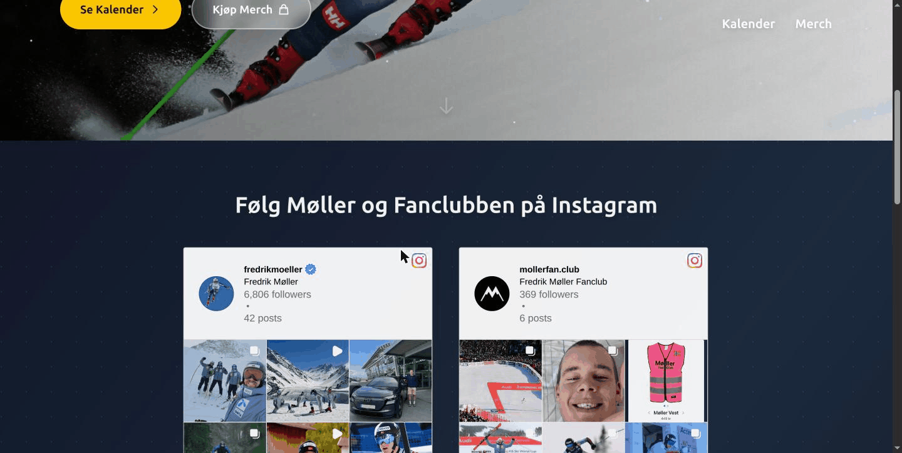

# Møller Fanclub ⛰️⛷️


## Forutsetninger

-   [Node.js](https://nodejs.org/) (versjon >=20.19.0)
-   [Sanity](https://www.sanity.io/) - Headless CMS for innholdsadministrasjon
-   [PostgreSQL](https://www.postgresql.org/) - Database for ordrer og brukerdata
-   [Docker](https://www.docker.com/) med Compose-pluginen (kun for produksjon)

## Arkitektur

Prosjektet består av tre hovedkomponenter:

-   **Frontend** - React-applikasjon bygget med Vite og TypeScript
-   **Backend** - Express API-server bygget med TypeScript
-   **Sanity Studio** - Headless CMS for innholdsadministrasjon (studio-moller-fanclub)

## Oppsett

### Installer avhengigheter

For å installere alle avhengigheter (root, backend, frontend og Sanity Studio):
``` bash
npm run install:all
```

## Kjøring

### Utviklingsmodus

For å kjøre backend, frontend og Sanity Studio samtidig i utviklingsmodus:
``` bash
npm run dev
```

Dette starter:
- Backend på [http://localhost:3001](http://localhost:3001)
- Frontend på [http://localhost:5173](http://localhost:5173)
- Sanity Studio på [http://localhost:3333](http://localhost:3333)

### Kjør komponenter separat

Hvis du ønsker å kjøre komponentene separat:

**Backend:**
``` bash
npm run dev:backend
```

**Frontend:**
``` bash
npm run dev:frontend
```

**Sanity Studio:**
``` bash
npm run dev:studio
```

### Produksjon

For å bygge prosjektet lokalt:
``` bash
npm run build
```

For å starte det bygde prosjektet lokalt:
``` bash
npm run start
```

## Hosting

Nettsiden kjører på en egen maskin hjemme ("Hub") bak en Cloudflare Tunnel. Det er ingen åpne porter på ruteren, og Cloudflare håndterer HTTPS.

```
Nettleser → Cloudflare → Tunnel (cloudflared) → Caddy :8080 ─┬→ frontend (statiske filer)
                                                              └→ /api/* → backend :3001 → PostgreSQL
```

Alt kjører i Docker Compose (`docker-compose.yml`):

| Tjeneste  | Beskrivelse                                                                  |
| --------- | ---------------------------------------------------------------------------- |
| `db`      | PostgreSQL 16 med volumet `pgdata`                                           |
| `backend` | Express API. Kjører `prisma db push` og starter serveren ved oppstart        |
| `web`     | Caddy. Serverer frontend (bygget med `VITE_API_URL=/api`) og proxyer `/api/*` |

`web` lytter kun på `127.0.0.1:8080`. Cloudflare Tunnel peker `mollerfan.club` og `www.mollerfan.club` hit.

### Deploy

Push til `main` kjører `.github/workflows/deploy.yml`:

1. Kobler til serveren via SSH gjennom Cloudflare Access (`ssh.mollerfan.club`) med en service token.
2. Synkroniserer koden med `rsync`.
3. Skriver `.env` på serveren fra GitHub Secrets.
4. Kjører `docker compose up -d --build`.

Alle hemmeligheter ligger i GitHub Secrets. `.env.example` viser hvilke variabler backend leser.

| Secret                                                                                                     | Bruk                                       |
| ---------------------------------------------------------------------------------------------------------- | ------------------------------------------ |
| `SSH_PRIVATE_KEY`, `SSH_HOSTNAME`, `DEPLOY_USER`, `DEPLOY_PATH`                                            | SSH til serveren                           |
| `CF_ACCESS_CLIENT_ID`, `CF_ACCESS_CLIENT_SECRET`                                                           | Cloudflare Access service token            |
| `POSTGRES_PASSWORD`                                                                                        | Databasepassord. Må ikke endres etter første oppstart |
| `BETTER_AUTH_SECRET`                                                                                       | Innlogging                                 |
| `EMAIL_USER`, `EMAIL_FROM_SHOP`, `AZURE_CLIENT_ID`, `AZURE_CLIENT_SECRET`, `AZURE_TENANT_ID`               | E-post via Microsoft Graph                 |
| `VIPPS_*`                                                                                                  | Vipps Checkout                             |
| `BRING_API_KEY`, `BRING_API_UID`, `BRING_CUSTOMER_NUMBER`, `SENDER_POSTAL_CODE`                            | Frakt                                      |
| `FRONTEND_URL` (valgfri)                                                                                   | Standard er `https://mollerfan.club`       |

### Nyttige kommandoer på serveren

``` bash
cd ~/fanclub
docker compose ps                  # status
docker compose logs -f backend     # logger
docker compose restart backend     # restart
docker compose exec db pg_dump -U fanclub fanclub > backup.sql   # backup av databasen
```

**Merk:** Databasen ligger kun på serveren. Ta jevnlig backup.

### Sanity Studio

Sanity Studio er et headless CMS som brukes til å administrere innhold på nettsiden. Innholdet inkluderer produkter, bilder, tekster og andre dynamiske data.

**Bygge Sanity Studio for produksjon:**
``` bash
npm run build:studio
```

**Starte Sanity Studio i produksjonsmodus:**
``` bash
npm run start:studio
```

**Deploye Sanity Studio til Sanity's hosting:**
``` bash
cd studio-moller-fanclub && npm run deploy
```

For mer informasjon om Sanity, se [Sanity dokumentasjonen](https://www.sanity.io/docs).

### Prisma (Database)

Prisma brukes til å administrere databasen for ordrer, betalinger og brukerdata. Backend bruker PostgreSQL som database.

**Generer Prisma Client:**

Etter å ha installert avhengigheter, må Prisma Client genereres basert på databaseskjemaet:
``` bash
cd backend && npm run db:generate
```

Dette kommandoen kjører `prisma generate` og genererer TypeScript-typer basert på `prisma/schema.prisma`.

**Kjør database-migrasjoner:**

For å oppdatere databasestrukturen i produksjon:
``` bash
cd backend && npm run db:migrate
```

**Åpne Prisma Studio:**

Prisma Studio er et GUI-verktøy for å se og redigere data i databasen:
``` bash
cd backend && npm run db:studio
```

Dette åpner Prisma Studio på [http://localhost:5555](http://localhost:5555)

**Merk:** Lokalt må du ha en `DATABASE_URL` i `.env`-filen i backend-mappen for at Prisma skal fungere. I produksjon settes den av `docker-compose.yml`.

Det finnes ingen migrasjonsmappe ennå, så produksjon bruker `prisma db push` i stedet for `migrate deploy`.

For mer informasjon om Prisma, se [Prisma dokumentasjonen](https://www.prisma.io/docs).

